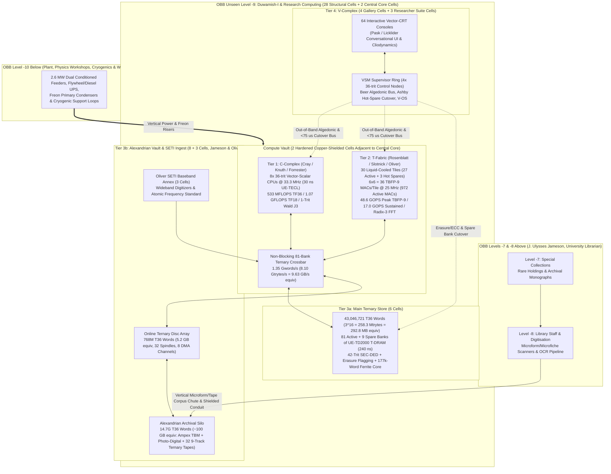
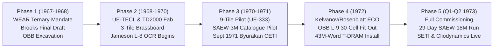

# Project Plan: The Duwamish-I System (`UE-1000`) — Revision 2 (Balanced-Ternary Baseline)

**Program Sponsor & Governance:** **WEAR** (Woodworth's UARC/FFRDC, A. J. Woodworth III University, West Seattle)  
**Mandated Hardware Builder:** **Special Systems Section, Universal Entropics** (West Seattle)  
**Installation Site:** **Unseen Level -9** (Duwamish & Research Computing — **28 structural cells + 2 central core cells**), Oral Bland Building (OBB), A. J. Woodworth III University  
**Construction & Commissioning Window:** 1967–1972 (OBB build & foundry ramp) · Fully installed and commissioned **Q2 1973**  
**Authorized Capital Budget:** **1.000 G$** (1967 USD, routed through WEAR)

> [!IMPORTANT]
> **Revision 2 Canon Lock:** This revision locks the **native balanced-ternary (`-1, 0, +1`)** hardware specification, word/tryte layout, captive ternary silicon roadmap, corrected OBB Unseen stratigraphy (**Level -9**, fed by Levels -7/-8 above and Level -10 below), WEAR governance, restored **J. Ulysses Jameson** archival ownership, and **Frank Rosenblatt's** active 1967–1973 tenure (including his September 1971 Byurakan CETI exchange with **Pavel Kelvanov**). All sustained throughput, memory capacity, and workload feasibility numbers have been recalculated **honestly** under 1968–1973 balanced-ternary semiconductor constraints — with zero fudging back to binary speeds — before moving to the *Principles of Operation* or simulator code.

---

## 1. Mission Charter, Ternary Mandate & Three Anchor Workloads

### 1.1 Why Balanced Ternary Is a Charter Axiom
Mainline **Universal Entropics** manufactures **denary (base-10)** commercial, industrial, and institutional computers. The **UE Special Systems Section** exists apart from mainline UE for one foundational reason: to build **native balanced-ternary (`T, 0, 1` representing `-1, 0, +1`)** scientific and cybernetic machines, extending the Soviet **Setun** (Moscow State University, 1958) and **Setun-70** (1970) ternary lineage and embodying three-valued logic (`TRUE [+1] | UNDECIDED [0] | FALSE [-1]`) directly in silicon and magnetic storage.

In Phase 1 (1967), Frederick Brooks, Seymour Cray, and Gordon Moore formally petitioned WEAR to abandon ternary hardware in favor of binary ECL-10K and binary MOS DRAM — accurately warning that custom ternary silicon would forfeit roughly **3× raw arithmetic throughput** and **~43% main-memory capacity** for the same **1.000 G$**. **WEAR and the UE Special Systems Charter overruled them.** Balanced ternary is therefore not a committee "darling"; it is a **hard institutional axiom**. Brooks's anti-CAMEL authority governs everything *within* that axiom — and Cray, Moore, Knuth, Slotnick, Rosenblatt, and Forrester have engineered the cleanest, densest native balanced-ternary supercomputer achievable in 1968–1973 physics.

### 1.2 Three Anchor Workloads (Recalculated for Native Ternary Hardware)
All three workloads execute on one coherent facility on **Unseen Level -9** of the Oral Bland Building, commissioned by **Q2 1973**:

| Mission | Scientific & Institutional Goal | Dominant Mathematical Kernel | Honest 1973 Ternary Feasibility Envelope |
|---|---|---|---|
| **1. Library-Scale Autoregressive AI (`SAEW`)** | Train a coherent, encyclopedic autoregressive language and reasoning model over the complete card catalogue and digitized research core of **A. J. Woodworth III University Library** (curated by **J. Ulysses Jameson** on Levels -7/-8). | Dense matrix–matrix multiply (GEMM), Good–Rosenblatt associative attention with three-valued gating, log-odds normalization, reverse-mode adjoint updates. | **Production (`SAEW-18M`):** $4.20 \times 10^{16}$ ops on 380M tokens → **28.6 days** @ **17.0 GOPS sustained**, 100% resident in **43.05M `T36` words** (`292.8 MB` equiv). **Full-Corpus Stretch (`SAEW-32M`):** $1.39 \times 10^{17}$ ops on 700M tokens → **94.8 days (1 academic quarter)** using in-place `TBFP-9` momentum compression. |
| **2. Wideband Signal Analysis & SETI** | Real-time and archival narrowband spectral search across millions of radio channels, de-dispersed pulsar/beacon detection, matched filtering, and sequential Bayesian evidence accumulation (Good's decibans & Wald 3-way verdicts). | Native **radix-3** & **mixed-radix-6 Good–Thomas PFA** 1D/2D FFTs, polyphase filterbanks, triad-packed cross-correlation, Wald sequential probability-ratio tests (`-1 / 0 / +1`). | **$3^{13} = 1{,}594{,}323$-point complex radix-3 FFT in 12.1 ms** (~**132M channels/sec** sustained @ 16.0 GOPS in `TBFP-9`), with native 1-trit Wald stopping verdicts and zero rounding bias. |
| **3. OBB Cliodynamics ("Club of Rome on Steroids *and* Acid")** | Multi-century global socio-ecological-economic dynamics: coupled nonlinear stiff ODEs across hundreds of regions, institutional/trade networks, stochastic Monte Carlo ensembles ($10^3$–$10^4$ trajectories), and Ashby/Beer cybernetic stability-basin mapping. | Stiff implicit Runge–Kutta / BDF solvers in **47.5-bit-equivalent `TF36`** floating point (unbiased ternary rounding), dense `TBFP-9` regional coupling Jacobians, Lyapunov/Routh–Hurwitz stability diagnostics. | **533 MFLOPS peak (~250 MFLOPS sustained) `TF36`** on C-Complex + **17.0 GOPS sustained `TBFP-9`** on T-Fabric: 1,000-trajectory 48,600-ODE deep ensemble or 10,000-trajectory 5,400-ODE policy sweep in **~26 hours**; live 10-trajectory interactive CRT policy probes in **~47 seconds**. |

### 1.3 The Anti-CAMEL Unifying Principle
Left unchecked, a star-studded committee builds a **CAMEL** (*Committee-Assembled Machine of Every Luxury*). Under Brooks's rule — *every hardware mechanism must serve at least two of the three anchor workloads, or it is cut* — Duwamish-I rests on three unifying pillars:
1. **Low-precision native balanced-ternary linear algebra & radix-3/6 spectral butterflies (`TBFP-9`, 9-trit = 14.26-bit mantissa)** account for **> 95% of operations** across `SAEW` training, Rosenblatt associative arrays, Oliver SETI FFT banks, and dense cliodynamic Jacobian/coupling blocks — benefiting from **zero Booth recoding**, **unbiased truncation-as-rounding**, and **zero-trit power gating**.
2. **High-precision 36-trit (`TF36`, 30-trit = 47.55-bit mantissa) scalar & vector arithmetic** serves stiff cliodynamic integrators, exact reductions, Knuth symbolic/catalogue indexing, and Good's deciban sequential tests.
3. **Continuous out-of-band Beer/Ashby cybernetic telemetry & hot-spare self-healing** (paired with 42-trit SEC-DED + erasure-flagging ternary DRAM) is the *only* way a 1973 custom ternary supercomputer can sustain an unbroken **29-day to 95-day** training run without manual restarts.

---

## 2. Program Governance, Committee Roster & Anti-CAMEL Discipline

### 2.1 WEAR Funding & Institutional Ownership
- **WEAR (Woodworth's UARC/FFRDC):** Holds the **1.000 G$** federal/endowment capital charter, manages security compartments for OBB Unseen levels, audits milestones, and directs procurement.
- **Universal Entropics — Special Systems Section (West Seattle):** Mandated prime hardware builder, operating the captive ternary semiconductor/hybrid-MCM foundry program and assembling the `UE-1000` compute core and peripherals.
- **A. J. Woodworth III University Library (J. Ulysses Jameson):** Retains operational custody of the bibliographic stacks (**Level -7**), microform/microfiche digitization (**Level -8**), and the **Alexandrian Vault** archival store (**Level -9**).

### 2.2 Core Seven Consulting Architects
| Member | Primary Discipline | Core Contributions Locked into Duwamish-I |
|---|---|---|
| **Seymour Cray** | Supercomputer Hardware, Packaging & Cooling | Freon-cooled high-density `UE-TECL` ceramic MCM packaging, sub-2.5 m compute core wire lengths, hardwired load–store 36-trit vector–scalar pipelines (Cray-style 18-trit instruction parcels), ruthless physical decoupling of compute from I/O. |
| **Donald E. Knuth** | Algorithms, Balanced-Ternary ISA & Compilers | Co-signatory (with Cray) on the **36-trit word / 6-trit tryte** layout; strictly orthogonal ternary ISA; `TF36`/`TF18` exact unbiased rounding semantics; heptavintimal (`base-27`) listings; $V = 3^9$ morpheme tokenization; `SAL-3` compiler and reverse-mode `ADJOINT` runtime. |
| **I. J. Good** | Bayesian Statistics, Information Theory & AI | Weight-of-evidence (deciban) arithmetic in hardware accumulators; native 1-trit Wald 3-way stopping verdicts (`-1 / 0 / +1`); Bayesian log-odds formulation of `SAEW` associative attention; **Good (1958) Prime-Factor FFT** mapped directly onto radix-3/6 T-Tiles. |
| **Frank Rosenblatt** | Neurodynamics & Parallel Associative Arrays | **Active continuously through 1967–1973 commissioning** *(does not die in July 1971 in this timeline)*. Architects the T-Fabric's associative inner-product planes; attends the **September 1971 Byurakan CETI conference** in Soviet Armenia and confers with **Pavel Kelvanov** on Soviet Setun/Setun-70 ternary hardware — directly driving the late-1971 **Zero-Trit Gate-Suppress**, **Pure-Trit Associative Mode**, and **Three-Valued Attention Gating** refinements. |
| **W. Ross Ashby** | Cybernetics, Ultrastability & Variety | Law of Requisite Variety realized in microsecond digital crossbar reconfiguration onto hot-spare T-Tiles and DRAM banks, plus cliodynamic attractor/bifurcation stability diagnostics. |
| **Stafford Beer** | Management Cybernetics & Viable Systems | Viable System Model (VSM) built literally as the **out-of-band Algedonic Telemetry & Control Plane** (System 1 through System 5) monitoring every tile, Freon loop, and erasure flag with zero compute-cycle theft. |
| **Gordon Pask** | Conversation Theory & Adaptive Interaction | SAKI-descended adaptive conversational protocol on Level -9 vector-CRT consoles for querying `SAEW`, inspecting `UNDECIDED` (`0`) uncertainty states, and interactively steering cliodynamic policy landscapes. |

### 2.3 Institutional Lead, Added Committee Members & External Consultant
1. **Frederick P. Brooks Jr.** *(UNC Chapel Hill; Chief Architect of IBM System/360)* — **Chief System Architect & Final-Draft Authority.** Chairs the Architecture Board, enforces anti-CAMEL conceptual integrity within WEAR's balanced-ternary charter, and authors the final *Principles of Operation*.
2. **J. Ulysses Jameson** *(University Librarian, A. J. Woodworth III University; Cleared Archival Custodian for WEAR)* — **Library Stacks, Level -8 Digitisation Pipeline & Alexandrian Vault Lead.** Owns the Level -7 Special Collections feeds, manages the 150-person Level -8 microform/microfiche/OCR digitization pipeline (1969–1972), controls corpus curation and security provenance, and commands the Level -9 **Alexandrian Vault** mass-storage cells.
3. **Jay W. Forrester** *(MIT Sloan; Core Memory & System Dynamics Pioneer — World Dynamics 1971)* — **Cliodynamics & Hierarchical Store Lead.** Directs the multi-regional stiff cliodynamics engine (`DYNAMO-X`), bridges Ashby/Beer stability theory with implicit numerical integration, and architects the **Setun-style dual-core ferrite non-volatile Executive store** alongside the ternary memory hierarchy.
4. **Daniel L. Slotnick** *(University of Illinois; SOLOMON & ILLIAC IV Architect)* — **T-Fabric Systolic Array Lead.** Co-designs the 30-tile liquid-cooled systolic fabric with Rosenblatt, applying ILLIAC IV's real 1968–72 lessons (compact low-precision PEs, local bipolar SRAM reuse, hot-spare blades, and ABFT checksums).
5. **Bernard M. Oliver** *(VP of R&D, Hewlett-Packard; NASA Project Cyclops 1971 Co-Director)* — **SETI, Wideband DSP & Instrumentation Lead.** Ensures the $6 \times 6$ T-Tiles double seamlessly as radix-3/6 complex FFT butterfly engines, designs the isolated Level -9 baseband digitizer bays, and leads the US technical delegation alongside Rosenblatt at Byurakan (September 1971).
6. **Gordon E. Moore** *(Fairchild → Intel, 1968; Captive Foundry & Ternary Silicon Liaison)* — **Semiconductor Process & Yield Advisor.** After losing the binary-vs.-ternary charter debate, engineers the realistic 1968–1973 **240 M$ captive foundry roadmap**: precision thin-film trimmed **`UE-TECL`** hybrid ceramic MCMs and **`UE-TD2000` Differential 2-Cell Ternary MOS DRAM**, preventing unyieldable analog 3-level capacitor fantasies.
7. **J. C. R. Licklider** *(External Consultant, MIT / BBN; author of Libraries of the Future, 1965)* — **External Advisor on Interactive Terminals & Procognitive Indexing.** Advises Jameson on machine-readable catalogue schemas and pairs with Pask on the 64 interactive vector-CRT/light-pen workstations and the `CONVERSE` procognitive query language, without displacing Jameson's institutional custody of the OBB library or Alexandrian Vault.

### 2.4 Anti-CAMEL Governance: Brooks's Final Draft ("Darlings Killed")
Balanced ternary is preserved by **Charter Axiom** (WEAR / UE Special Systems mandate). Every other luxury that fails Brooks's two-workload rule remains **killed**:

| Darling Proposed | Champion(s) | Why Brooks Killed It | Coherent Native-Ternary Replacement Kept in Duwamish-I |
|---|---|---|---|
| **Electrochemical / Wetware Self-Organizing "Thread" Tank** | Pask | Uncalibratable, glacially slow, and hazardous beside 2.6 MW of Freon-cooled `UE-TECL` cabinets. | Digital synaptic plasticity on the balanced-ternary T-Fabric + interactive SAKI-style conversational CRT workstations (Pask + Licklider). |
| **Analog Potentiometer / Optical-Disk Synaptic Weights** | Rosenblatt | Thermal drift and ~6-bit SNR ruin multi-layer reverse-mode credit assignment across a 29-day or 95-day training run. | Exact digital **`TBFP-9`** (9-trit = 14.26-bit balanced mantissa, shared 6-trit exponent, 27-trit accumulation) + Rosenblatt–Kelvanov pure-trit `{-1, 0, +1}` associative mode. |
| **No Virtual Memory / Batch-Only Purism** | Cray | Incompatible with 64 interactive OBB research consoles, conversational `SAEW` queries, and Jameson's multi-gigatryte Alexandrian Vault. | **Strict Physical Decoupling:** C-Complex and T-Fabric execute bare-metal, deterministic, and interrupt-free (`C-EXEC`); virtual memory, capability security, and interactive time-sharing live exclusively on the isolated **V-Complex** (`V-OS`). |
| **100-Dial Analog Cybernetic War-Room Wired Inline into the CPU** | Beer | Polling compute registers in-band steals crossbar bandwidth and injects single-point failure modes. | Dedicated **out-of-band Algedonic Telemetry Bus** feeding Beer's Level -9 Operations Gallery with zero compute-cycle overhead. |
| **Writable Microcode on Main Compute CPUs** | Good, Knuth | Microcode fetch/decode adds 3×–5× cycle penalty atop `UE-TECL`'s already tighter 30 ns cycle budget and destroys deterministic pipeline timing. | Hardwired pipelines on all C-Complex and T-Fabric units; writable control store is restricted strictly to I/O channel controllers and V-Complex supervisory nodes. |
| **Physical Relay Uniselectors in Hardware** | Ashby | Millisecond electromechanical latency cannot match 30–40 ns silicon. | Hardware physical-noise ternary entropy generator + `< 75 µs` digital crossbar cutover onto hot-spare tiles and DRAM banks. |

---

## 3. Balanced-Ternary Word, Tryte & Data Architecture (Knuth–Cray Sign-Off)

### 3.1 Proposed Layout: The **36-Trit Word (`T36`)** and **6-Trit Tryte**
After evaluating 27-trit (too narrow for stiff cliodynamics: only 34.9-bit float mantissa), 42-trit / 45-trit (awkward prime factors 7 and 5 break half/quarter packing), and 54-trit (85.6 bits — wastes ~33% of scarce 1973 ternary DRAM and crossbar wires), Knuth and Cray sign off on the **36-trit full word (`T36`)** built from **6-trit trytes**.

Because $36 = 2^2 \times 3^2$ and $1\text{ trit} = \log_2 3 \approx 1.58496\text{ bits}$, a **36-trit word carries 57.06 bits of information** — landing squarely in Seymour Cray's proven 60-bit supercomputer sweet spot (CDC 6600/7600) while dividing cleanly into every canonical Setun and matrix-lane sub-unit:

```text
|<------------------------------- 36-Trit Full Word (T36, 57.06 bits) ------------------------------>|
|<- 18-Trit Setun Half-Word (T18, 28.53b) ->|<- 18-Trit Setun Half-Word (T18, 28.53b) ->|
|<- 9t Nonet ->|<- 9t Nonet ->|<- 9t Nonet ->|<- 9t Nonet ->|   (4x TBFP-9 T-Fabric lanes)
| 6t  | 6t  | 6t  | 6t  | 6t  | 6t  |                           (6x 6-trit Setun-70 / Knuth trytes)
|3|3|3|3|3|3|3|3|3|3|3|3|                                       (12x heptavintimal digits: 0, A-M, N-Z)

Stored Main Memory Word (42 trits = 7 trytes):
[ 36 Data Trits (6 trytes) ] + [ 6 ECC Check Trits (1 ECC tryte) ] -> [42, 36, 4]_3 SEC-DED + 3-Erasure
```

### 3.2 Complete Sub-Unit Table & Justification Across All Three Constraints
| Unit | Width | States / Range | Bit Equiv. | Packing / Word | Engineering Justification (C-Complex, T-Fabric & Setun Lineage) |
|---|---|---|---|---|---|
| **Trit** | 1 trit | `T, 0, 1` (`-1, 0, +1`) | 1.585 b | 36 | Native Kleene three-valued logic (`FALSE / UNDECIDED / TRUE`), single-trit condition code `C`, Wald 3-way branch `J3`, zero-trit power gating. |
| **Triad** | 3 trits | 27 (`±13`) | 4.755 b | 12 | One **heptavintimal** listing character (`0, A..M, N..Z`, UE house notation); also T-Fabric **`TBFP-3`** compressed inference / coarse SETI correlation lane (3 per 9-trit MAC). |
| **Tryte** | **6 trits** | **729 (`±364`)** | **9.510 b** | **6** | **Exact Brusentsov Setun-70 (1970) & Knuth (*TAOCP* Vol. 2) tryte.** Holds Jameson's complete OBB bibliographic character set (Latin, Cyrillic, Greek, diacritics, math, MARC control codes) in one tryte with zero shift-escape states. Also equals 1 ECC check tryte. |
| **Nonet** | **9 trits** | **19,683 (`±9,841`)** | **14.265 b** | **4** | **Exact Setun (1958) syllable width.** Primary T-Fabric **`TBFP-9`** training & FFT mantissa (14.26 bits — *exceeding* binary BFP16's 12-bit mantissa!) and exact `SAEW` vocabulary token ID ($V = 3^9 = 19{,}683$, 4 tokens/word). |
| **Half-Word (`T18`)** | **18 trits** | **387.4M (`±193.7M`)** | **28.529 b** | **2** | **Literal trit-for-trit Setun (1958) & Setun-70 (1970) word compatibility!** Enables: (1) Cray-style **two 18-trit register-register instruction parcels** per 36-trit fetch; (2) **`TF18`** single-precision float (`13t` mantissa [20.6b] + `5t` exp [`10^±57.7`]) for `SAEW` master weights/momentum & Good deciban accumulators; (3) one **complex `TBFP-9` FFT sample** (`9t Re + 9t Im`). |
| **Full Word (`T36`)** | **36 trits** | **$1.50 \times 10^{17}$ (`±7.50×10^{16}`)** | **57.059 b** | **1** | **`TF36` high-precision float:** **30-trit balanced mantissa (47.55 bits — matching Cray's CDC 7600 48-bit mantissa, with strictly unbiased truncation-as-rounding!)** + **6-trit balanced exponent (`±364` → $3^{\pm 364} \approx 10^{\pm 173.7}$)**. Eliminates rounding drift in stiff 200-year cliodynamics integrators. |

### 3.3 Native Ternary ECC (`[42, 36, 4]_3` Code — 1 ECC Tryte per Word)
Over $\mathrm{GF}(3)$, a 4-trit check field yields the **perfect ternary Hamming code** $[40, 36, 3]_3$ (`SEC`, zero wasted syndromes). Adding 2 more check trits (expanding to a clean **6-trit ECC tryte**, yielding a **42-trit = 7-tryte** stored memory word) gives a shortened $[42, 36, 4]_3$ linear code ($d_{\min} = 4$, constructible directly over $\mathrm{GF}(3)^6$ with up to 56 columns):
- **Corrects any 1 arbitrary trit error** (`SEC`) and **detects any 2 arbitrary trit errors** (`DED`).
- **Paired with `UE-TD2000` Differential T-DRAM erasure flagging** (Section 4.1), any single-capacitor leakage fault raises the forbidden `(1,1)` state as a *known erasure location* — allowing the 6-trit ECC hardware to **correct up to 3 simultaneous capacitor erasures per word** in a single memory cycle!

---

## 4. Captive Ternary Silicon Roadmap (`240 M$`) & Four-Tier Hardware Architecture

### 4.1 Captive Foundry Strategy (1968–1973, Gordon Moore & UE Special Systems)
Because Duwamish-I cannot ride the 1968–72 commercial binary TTL/MECL-10K or Intel 1103 DRAM wave, the **240 M$ captive foundry allocation** (West Seattle packaging works + dedicated Santa Clara wafer line) builds **three disciplined native-ternary device families** — strictly avoiding unyieldable 3-level analog MOS capacitors:

1. **Logic (`UE-TECL` — Differential Current-Steering Ternary ECL, 1968–71):**
   - Uses **symmetric three-level current steering** (`-0.8 V / 0.0 V / +0.8 V` with precision bandgap/diode center reference and laser-trimmed thin-film resistors on multi-chip alumina hybrid modules) under tight **$\pm 3^\circ\text{C}$ Freon cold-plate control**.
   - **Honest electrical trade-off:** Noise margin per threshold step is halved ($0.4\text{ V}$ vs. $0.8\text{ V}$ binary ECL), requiring controlled edge slew and dual-threshold comparators → **3.3 ns/gate** vs. 2.0 ns binary (**1.5×–1.6× clock penalty**), and **~1.7× power/area per equivalent bit-op**. Partially offset by **37% fewer package pins and backplane wires** ($1/\log_2 3 = 0.631\times$), zero sign/Booth/rounding logic, and zero-trit idle current suppression.
2. **Main Memory (`UE-TD2000` — $3^7 = 2{,}187$-Trit Differential 2-Cell Ternary MOS DRAM, 1969–72):**
   - Rather than storing fragile 3-level analog voltages on one capacitor, each trit uses a **matched differential pair of proven 1972 dynamic MOS capacitors** on one sense line: `(1,0) = +1`, `(0,0) = 0`, `(0,1) = -1`, and **`(1,1) = HARDWARE ERASURE FAULT`** — the exact silicon descendant of Brusentsov's Setun dual-ferrite-core trit cell!
   - A 4,374-capacitor MOS die (same lithography class as 1972 4K binary DRAM) delivers **$3^7 = 2{,}187$ native trits** through **true 3-level address/data pins** (only **7 address pins** per chip!).
   - **Honest density & yield penalty:** Information density per capacitor is $\log_2(3)/2 = 79.25\%$; factoring in differential sense-amp area, 6-trit ECC (16.7% overhead), and ~65% captive wafer yield without commercial volume, the **145 M$ memory/storage + 240 M$ fab** budget produces **918,540 tested `UE-TD2000` chips** (yielding **43.05M `T36` words ≈ 292.8 MB equivalent** — an honest **43% reduction** vs. binary's 512 MB!).
3. **Non-Volatile Executive Store (Forrester–Setun Dual-Core Magnetic Ferrite Vault, 1968–70):**
   - **$3^{11} = 177{,}147$ `T36` words** (600 ns cycle, ~1.2 MB equiv) of radiation- and power-loss-immune dual-core ferrite memory holding `C-EXEC`, cold-boot diagnostics, and V-Complex recovery descriptors.

### 4.2 Four-Tier System Topology (Unseen Level -9)



### 4.3 Tier-by-Tier Hardware Specifications

#### Tier 1 — C-Complex (Cray–Knuth–Forrester 36-Trit Vector–Scalar Engine)
- **Topology:** **8 symmetric hardwired 36-trit load–store vector–scalar processors** in an octagonal column inside the **2-Cell Compute Vault** (max compute-to-crossbar wire length `< 1.4 m`).
- **Clock & Logic:** **30 ns (33.33 MHz)** `UE-TECL` multi-chip alumina modules on direct Freon cold plates (honest **1.5× slowdown** vs. binary's 20 ns).
- **Register File & Native Ternary ISA (Knuth):**
  - **9 scalar 36-trit registers (`S0–S8`, `S0 ≡ 0`, 2-trit register field `-4..+4`)**, **9 address/index registers (`A0–A8`)**, and **9 chainable vector registers (`V0–V8`, each $3^3 = 27 \times 36$-trit elements)** — matching the 27 active T-Tiles cleanly.
  - **Dual-Parcel Instruction Fetch:** One 36-trit word holds either **two 18-trit Setun-length compact register-register instructions** or **one 36-trit full-address/vector/T-Fabric descriptor**.
  - **Native Arithmetic & Logic:** `TF36` (30t mantissa = 47.55 bits, 6t exp = $10^{\pm 173.7}$), packed 2-way `TF18` (13t mantissa = 20.6 bits, 5t exp = $10^{\pm 57.7}$), 36-trit signed integer, **Good Deciban** saturated log-odds ALU, Kleene tritwise `AND` (min) / `OR` (max) / `NOT` (negate) / `EQV` (trit product) / `SEL` (3-entry truth table), and single-trit condition code `C ∈ {T, 0, 1}` driving single-cycle 3-way branch **`J3`**.
- **Honest Performance:** **533 MFLOPS peak `TF36`** (~250 MFLOPS sustained on stiff BDF/RK), **1.07 GFLOPS peak `TF18`**, **267 MIPS** scalar peak.

#### Tier 2 — T-Fabric (Rosenblatt–Slotnick–Oliver Ternary Systolic & Radix-3/6 FFT Array)
- **Physical Layout:** **30 identical liquid-cooled field-replaceable blades ("Tiles")** ringing the C-Complex inside the **2-Cell Compute Vault**: **$27\text{ active } (3^3) + 3\text{ hot spares}$**.
- **Inside Each Tile:**
  - **$6 \times 6 = 36$ pipelined `TBFP-9` MAC units** running at **40 ns (25 MHz)** (~850 `UE-TECL` gates/MAC → ~30,600 arithmetic gates/tile; ~918K arithmetic gates + control ≈ **1.35M total gates** across all 30 tiles).
  - **Exact 27-Trit Accumulator (`±3.81×10^{12}`, 42.8 bits):** Zero overflow over $10^4+$ MAC terms; re-quantization back to `TBFP-9` requires **zero rounding adder** (truncation *is* unbiased round-to-nearest!).
  - **Local Tile Store:** **$3^8 = 6{,}561$ `T36` words** (`39,366` trytes ≈ **46.8 KB equiv**) of 40 ns bipolar ternary SRAM per tile (**1.40 MB equiv** across 30 tiles), delivering **> 145 GB/s equiv** internal operand-reuse bandwidth.
  - **Four Dual-Use / Kelvanov-Refined Operating Modes:**
    1. **Dense Matrix / Training Mode (`TBFP-9`, 9-trit = 14.26-bit mantissa + shared 6-trit block exp):** 1 MAC/cycle per PE, 4 elements packed per `T36` word. **48.6 GOPS peak** (24.3 GMAC/s); **17.0 GOPS sustained** (35% end-to-end training efficiency).
    2. **Spectral Butterfly Mode (Oliver SETI / Cliodynamic PDEs):** Reconfigures each $6 \times 6$ tile into **9 complex radix-3 FFT butterfly pipelines** (or **6 mixed-radix-6 Good–Thomas PFA engines**) operating on packed 18-trit (`9t Re + 9t Im`) `TBFP-9` complex pairs with hardware trit-reversed address generators.
    3. **Compressed Triad Mode (`TBFP-3`, 3-trit = 4.75-bit, 27 levels, $\pm 13$):** Splits each 9-trit lane into **3 independent heptavintimal triads** → **145.8 GOPS peak** (~48 GOPS sustained) for high-concurrency interactive `SAEW` inference and coarse wideband SETI correlation (never fudged into dense training math!).
    4. **Rosenblatt–Kelvanov Pure-Trit Associative Mode (`{-1, 0, +1}`, late-1971 Byurakan ECO):** Adds **zero-trit gate suppression** (cutting dynamic tile heat ~18–22% on sparse/abstained attention weights!) and a **9-parallel-trit-product associative inner-product path** (**437.4 G-trit-ops/s peak**) for rapid three-valued catalogue matching and Setun-compatible associative layers.

#### Tier 3 — Forrester–Moore–Jameson Hierarchical Store & Alexandrian Vault
- **Tier 3a — Main Semiconductor Store (6 Cells ringing the Central Core):**
  - **$3^{16} = 43{,}046{,}721$ `T36` words** (**258.28 Mtrytes ≈ 292.8 MB equivalent**) arranged as **81 active ($3^4$) + 9 hot-spare ($3^2$) banks** of $3^{12} = 531{,}441$ words each (918,540 `UE-TD2000` chips; 240 ns bank cycle, 42-trit SEC-DED + erasure flagging).
  - **Symmetric Physical Addressing:** 16-trit balanced physical address (`-21,523,360` to `+21,523,360`); negative space hardware-protected for `C-EXEC` / V-Complex descriptors, positive space for user/tensor arenas (18-trit logical address space).
  - **Non-Volatile Ferrite-Core Executive Vault:** **$3^{11} = 177{,}147$ `T36` words** (600 ns dual-core ferrite).
  - **Crossbar Bandwidth:** 81-way non-blocking ternary crossbar @ 60 ns pipelined burst = **$1.35\text{ Gwords/s} = 8.10\text{ Gtrytes/s} \approx 9.63\text{ GB/s equiv}$** peak (~6.5 GB/s sustained).
- **Tier 3b — Online Ternary Disc & The Alexandrian Vault (8 Cells, J. Ulysses Jameson):**
  - **Online Ternary Disc Array:** 32 UE-modified IBM 3330-class spindles using ternary flux-group recording (5 trits per 8 flux transitions) on 8 parallel DMA channels → **$768\text{M}$ `T36` words (4.61 Gtrytes ≈ 5.2 GB equiv)** at ~20 MB/s equiv sustained streaming. Holds Jameson's full tokenized corpus, card-catalogue inverted B-trees, and live training/cliodynamics checkpoints.
  - **Alexandrian Archival Silo:** Ampex TBM (1971) cartridge silo + IBM 1360-class photo-digital archival vault + **32 high-speed 9-track ternary tape drives** (1 trit/track, 4 frames/`T36` word) → **$14.7\text{G}$ `T36` words (~88 Gtrytes ≈ ~100 GB equiv)** archival store, fed directly down from Jameson's Level -8 Digitisation floor.

#### Tier 4 — V-Complex (Beer–Ashby–Pask–Licklider Control & Conversation Plane, 4 + 3 Cells)
- **System 1–2 (Operations & Anti-Oscillation):** Hardware crossbar arbitration and deterministic barrier rings across the 27 active tiles, 8 C-CPUs, and 81 DRAM banks.
- **System 3 & 3\* (Homeostasis & Out-of-Band Algedonic Channel):** 4 fault-tolerant 36-trit supervisory nodes continuously monitor Freon temperatures, `UE-TD2000` `(1,1)` erasure rates, ECC syndrome counters, and **ABFT (Algorithm-Based Fault Tolerance)** ternary row/column checksums on every tile. When a tile faults or thermal margin drifts, the Algedonic bus triggers **Ashby Ultrastable Cutover** — isolating the tile, remapping the crossbar LUT, and reloading the local tile SRAM onto one of the **3 hot-spare tiles in `< 75 µs`** (followed by deterministic micro-block replay) and lighting the exact maintenance bay in Beer's glass-walled Level -9 Operations Gallery without aborting a multi-month training run.
- **System 4–5 (Conversation & Steering):** Drives **64 interactive vector-CRT + keyboard + light-pen workstations** (3 researcher suite cells on Level -9 plus fiber/coax drops to OBB faculty offices and Jameson's Level -8 staff stations).

---

## 5. Honest Quantitative Feasibility Proof (Zero Binary Fudging)

### 5.1 Binary Counterfactual vs. Native Balanced-Ternary Accounting
To verify complete numerical honesty — and confirm Brooks, Cray, and Moore's original 1967 penalty estimate — every hardware metric is audited directly against the overruled binary draft at the same **1.000 G$** budget:

| System Metric | Overruled Binary Counterfactual (Rev 1) | Locked Native Balanced-Ternary `UE-1000` (Rev 2) | Real Hardware Ratio & Physical Cause |
|---|---|---|---|
| **C-Complex Clock / Peak High-Prec.** | 20 ns (50 MHz) · 0.80 GFLOPS (`FP64`) | **30 ns (33.3 MHz) · 0.533 GFLOPS (`TF36`, 47.5b mant)** | **0.67×** (3-level `UE-TECL` threshold settling & ternary carry) |
| **T-Fabric Active MACs & Clock** | 32 tiles × 64 (8×8) @ 40 MHz = 2,048 MACs | **27 tiles × 36 (6×6) @ 25 MHz = 972 `TBFP-9` MACs** | **0.47× MACs × 0.625× clock = 0.297×** (custom `UE-TECL` area/power; zero commercial MSI parts) |
| **T-Fabric Peak / Sustained Training** | 163.8 GOPS peak · **55.0 GOPS sustained** | **48.6 GOPS peak · 17.0 GOPS sustained** (`TBFP-9`, 35% eff.) | **0.31× (3.24× slower)** — confirms Brooks/Cray's 3×–5× warning! |
| **Main Semiconductor RAM** | 512 MB (`64M × 64b`, 128 banks 4K DRAM) | **292.8 MB equiv (`43.05M × T36` = $3^{16}$ words, 81 banks)** | **0.57× (43% smaller)** (2-cell differential `UE-TD2000` + 6-trit ECC + 65% captive yield) |
| **Crossbar Peak Bandwidth** | 25.6 GB/s (~16 GB/s sustained) | **9.63 GB/s equiv (`1.35 Gwords/s`, ~6.5 GB/s sust)** | **0.38×** (81 banks @ 60 ns ternary burst vs. 128 @ 40 ns binary) |
| **1-Month `SAEW` Production Model** | `SAEW-34M` (33.6M params, 700M tok, 30.7 d) | **`SAEW-18M` (17.71M params, 380M tok, 28.6 d, 100% RAM)** | **Honest ~1.9× parameter scale-down** to hold 1-month window & zero disc paging |
| **Full ~33M-Param Model Wall-Clock** | 30.7 days (`SAEW-34M`, 700M tokens) | **94.8 days (~1 academic quarter, `SAEW-32M`, 700M tok)** | **3.09× longer**; requires Knuth in-place `TBFP-9` momentum compression to stay RAM-resident |
| **SETI Coherent FFT Throughput** | > 300M ch/s (1M-pt radix-4 in ~2.5 ms) | **~132M ch/s ($3^{13} = 1.59\text{M}$-pt radix-3 in 12.1 ms)** | **0.44×** (honest `TBFP-9` slowdown, still exceeds 1971 Project Cyclops narrowband targets) |

---

### 5.2 Workload 1: Library-Scale Autoregressive AI (`SAEW-1`)

#### A. 1969–1972 In-Universe Genealogy (Preserved + Byurakan Refinement)
The committee derives the architecture organically in 1969–1972 as **`SAEW-1` (*Sequential Associative Evidence-Weighted* Autoregressive Model)**:
- **Natural Ternary Subword Vocabulary ($V = 3^9 = 19{,}683$):** Knuth & Good's frequency-merged morpheme/digram dictionary built with Good–Turing smoothing over Jameson's corpus — every token ID occupies **one exact 9-trit nonet** (4 tokens per `T36` word).
- **Content-Addressable Associative Attention (Good + Rosenblatt):** Compatibility $q_i \cdot k_j / \sqrt{d_k}$ is formulated explicitly as **Good's log-likelihood weight of evidence (decibans)** that context token $j$ predicts the next symbol; exponentiation and normalization produce **Bayesian posterior retrieval weights** over past memory vectors $V$.
- **Three-Valued Associative Gating (Rosenblatt–Kelvanov Refinement, Q4 1971):** Following Rosenblatt's September 1971 Byurakan conversations with **Pavel Kelvanov** on Setun three-valued matching, attention heads apply a native Wald dead-zone gate (`+1` retrieve / `0` abstain-undecided / `-1` inhibit), suppressing spurious low-evidence cross-terms and triggering the T-Fabric's **zero-trit power gating**.
- **Reverse-Mode Adjoint Credit Assignment:** Derived from Kelley (1960) / Bryson & Ho (1969) adjoint optimal control (Forrester) and Linnainmaa's (1970) reverse-mode automatic differentiation (formalized by Knuth in `ADJOINT`).

#### B. Corpus Sizing: A. J. Woodworth III University Library (Jameson's Level -7 / -8 Pipeline)
| Corpus Component | Physical Source & Level | Machine-Readable Tokens | Native Tokenized Store (1 Nonet/Token) |
|---|---|---|---|
| **Complete Card Catalogue** (author, title, LC subjects, cross-refs, abstracts) | ~2.0M volumes (~6M cards), Level -8 pipeline | **~300M tokens** | 75M `T36` words (~0.51 GB equiv) |
| **Digitized Core Research Collection** (microform/microfiche & OCR, 1969–72: encyclopedias, core monographs, journals, Special Collections abstracts) | **~10,000–15,000 curated volumes**, Levels -7 & -8 | **~700M tokens** | 175M `T36` words (~1.19 GB equiv) |
| **Total Active Training Corpus** | Full Catalogue + Core Collection | **~1.0B tokens** | **250M `T36` words (~1.70 GB equiv)** — fits **3.0×** inside the 5.2 GB equiv online ternary disc array! |

#### C. Honest Model Specifications, Exact RAM Accounting & Training Times
Every dimension is an exact multiple of 6, 9, and 27 to eliminate tile padding waste on the $6 \times 6$ T-Tiles, using **chunked single-sequence softmax** ($T = 3^5 = 243$ tokens) so logits never blow out main memory:

1. **Commissioning Production Model — `SAEW-18M` (Q1–Q2 1973 Acceptance Run):**
   - **Geometry:** $L = 9$ layers, $d_{\text{model}} = 324$ ($9 \times 36$), $n_{\text{heads}} = 9$ ($d_k = 36$), $d_{\text{ff}} = 1{,}296$ ($4 d$), context $T = 243$, tied embeddings ($V = 19{,}683$).
   - **Parameters:** $6.38\text{M (embed)} + 9 \times 12 \times 324^2 = 6.38\text{M} + 11.34\text{M} = \mathbf{17.71\text{M parameters}}$.
   - **Chinchilla-Balanced Training Tokens ($D / N = 21.5$):** **$380\text{M tokens}$** (1 full pass over Jameson's entire 300M-token card catalogue + 80M tokens of encyclopedic/core reference works).
   - **Exact Arithmetic Operations ($6 N D + 6 L T d D$):**
     $$C_{\text{train}} = 6(1.771 \times 10^7)(3.80 \times 10^8) + 6(9)(243)(324)(3.80 \times 10^8) = 4.038 \times 10^{16} + 0.162 \times 10^{16} = \mathbf{4.20 \times 10^{16}\text{ ops}}$$
   - **Exact Resident RAM Budget (in 43.05M `T36` words — ZERO disc paging!):**
     - `TBFP-9` active weights (4/word): `4.43M` words
     - `TF18` master weights (2/word): `8.86M` words
     - `TF18` momentum state (2/word): `8.86M` words
     - `TF18` separate gradient accumulator (2/word): `8.86M` words *(droppable to `0` via in-place accumulation to free `8.86M` words)*
     - Checkpointed activations + active layer workspace + chunked 243-token softmax ($B_\mu = 9$, 2 accum steps → effective batch 18): `6.60M` words
     - `C-EXEC` / DMA ring buffers: `2.00M` words
     - **Total = `39.60M` / `43.05M` `T36` words** (`+3.45M` words / `+23.4 MB` equiv clean headroom!).
   - **Honest Wall-Clock Training Time at 17.0 GOPS Sustained:**
     $$T_{\text{train}} = \frac{4.20 \times 10^{16}\text{ ops}}{1.70 \times 10^{10}\text{ ops/s}} = 2.47 \times 10^6\text{ s} \approx \mathbf{28.6\text{ days}}$$
   - **Interactive Inference Speed (Level -9 & OBB Consoles):** Generating 1 token requires $2N = 3.54 \times 10^7$ ops. A **single T-Tile** (`0.65 GOPS` sustained `TBFP-9`; `1.80 GOPS` sustained `TBFP-3` triad mode) delivers **18.3 tokens/sec (`TBFP-9`)** or **50.8 tokens/sec (`TBFP-3`)** — supporting **up to 27 simultaneous researchers** conversing smoothly in real time!

2. **Full-Corpus Stretch Model — `SAEW-32M` (Academic-Quarter Run, Direct Ternary Counterpart to Rev 1's 34M Model):**
   - **Geometry:** $L = 8$ layers, $d_{\text{model}} = 486$ ($9 \times 54$), $n_{\text{heads}} = 9$ ($d_k = 54$), $d_{\text{ff}} = 1{,}944$, $T = 243$, $V = 19{,}683$.
   - **Parameters:** $9.57\text{M (embed)} + 22.67\text{M (body)} = \mathbf{32.24\text{M parameters}}$, trained on **$700\text{M tokens}$** ($D / N = 21.7$).
   - **Exact Operations & Honest Wall-Clock Time:**
     $$C_{\text{train}} = 1.394 \times 10^{17}\text{ ops} \implies T_{\text{train}} = \frac{1.394 \times 10^{17}}{1.70 \times 10^{10}} = 8.20 \times 10^6\text{ s} \approx \mathbf{94.8\text{ days (~13.5 weeks / 1 academic quarter)}}$$
   - **Exact RAM Constraint (Honest Trade-Off):** Full separate `TF18` optimizer + grad buffers would need `64.4M` words (exceeding `43.05M` words by `21.4M` words). Therefore `SAEW-32M` uses **Knuth's in-place block-scaled `TBFP-9` momentum compression**: `8.06M` (`TBFP-9` weights) + `16.12M` (`TF18` master weights) + `8.06M` (in-place `TBFP-9` momentum) + `6.02M` (activations, $B_\mu = 6$) + `2.00M` (OS) = **`40.26M` / `43.05M` `T36` words** (`+2.79M` words headroom; zero disc paging!). *(Alternatively, full `TF18` momentum streams layer-by-layer over the 8-channel disc array at ~5% stall overhead → ~100 days.)*
   - **Why Beer & Ashby Are Essential:** Completing a 95-day run on 918,540 custom 1973 MOS chips and 1.35M `UE-TECL` gates is physically impossible without autonomous `< 75 µs` hot-spare tile cutover and 42-trit SEC-DED + erasure recovery.

---

### 5.3 Workload 2: Wideband Signal Analysis & SETI (Oliver + Good)
- **Native Radix-3 & Mixed-Radix-6 Spectral Search:** All 27 active T-Tiles in Spectral Butterfly Mode sustain **~16.0 GOPS** on complex `TBFP-9` (14.26-bit mantissa = **~86 dB spurious-free dynamic range**, crushing weak-carrier intermodulation noise!).
  - A **$3^{13} = 1{,}594{,}323$-point complex radix-3 FFT** requires $13 \times (3^{13}/3) \times 28 = 1.934 \times 10^8$ real ops → executes in **12.1 ms** (**131.9 million spectral channels/second** sustained; a $3^{12} = 531{,}441$-point transform finishes in **3.72 ms** = **142.9M channels/sec**).
  - While ~2.3× slower than the binary counterfactual, **132M channels/sec** in programmable digital hardware still surpasses the narrowband resolution of NASA's 1971 Project Cyclops optical-film design — and in **Triad Mode (`TBFP-3`)** performs coarse multi-beam de-dispersion and matched-filter correlation at **~45 GOPS sustained**!
- **Good's Native 3-Valued Sequential Evidence Engine:** C-Complex CPUs ingest spectral peaks directly in decibans and apply Wald's sequential test across Doppler-drift slopes and pulse-periodicity hypotheses, emitting hardware 1-trit verdicts: **`-1` (natural/noise rejected)**, **`0` (UNDECIDED — hold integration & refine beam)**, **`+1` (candidate artificial beacon flagged)**.

---

### 5.4 Workload 3: OBB Cliodynamics ("Club of Rome on Steroids *and* Acid")
Compare MIT's real 1971–72 **World3** (~150 variables, 1 region) against Duwamish-I's honest native-ternary capacity (**250 MFLOPS sustained `TF36`** on the 8 C-Complex CPUs + **17.0 GOPS sustained `TBFP-9`** on the 27 T-Tiles):
- **Two Coordinated Operational Regimes (Honest Wall-Clock Math):**
  1. **Deep Multi-Regional Socio-Ecological Model (`162` regions [$2 \times 3^4$] × `300` coupled state variables = `48,600` stiff nonlinear ODEs + institutional/trade network):**
     - Each 200-year trajectory (2,400 monthly stiff implicit steps, ~200 `TF36` flops/var/step on C-Complex + dense $162 \times 162$ regional trade/migration/resource coupling matrices offloaded to T-Fabric in `TBFP-9`) takes **~93 seconds** (`2.33 × 10^{10}` `TF36` flops).
     - A **1,000-trajectory Monte Carlo & counterfactual ensemble** completes in **~25.9 hours (~1.1 days)** — with **unbiased balanced-ternary rounding** in `TF36` (47.55-bit mantissa) eliminating systematic numerical drift over 200-year stiff integrations.
  2. **10,000-Trajectory Policy-Space & Attractor-Basin Sweep (`108` regions × `50` core variables = `5,400` stiff ODEs + `TBFP-9` coupling):**
     - Sweeping 10,000 policy/shock/delay combinations completes in **~25.9 hours**, allowing Ashby/Beer stability algorithms to map **attractor basins, tipping cliffs, and viable policy corridors**.
  3. **Live Interactive CRT Policy Steering (Pask / Forrester / Licklider):**
     - On an OBB vector-CRT console, adjusting policy levers with a light-pen launches a **10-trajectory uncertainty bracket** on a 54-region (`2,700`-ODE) model that completes in **~47 seconds** (rendering live phase-space trajectories as months integrate).

---

## 6. Software & Language Stack (Knuth & Brooks)

Three strictly orthogonal layers targeting the native 36-trit C-Complex + T-Fabric architecture:

1. **System & Kernel Executive (`V-OS` & `C-EXEC`):**
   - `V-OS` runs on the 4-node V-Complex: multi-user time-sharing, WEAR compartment capability security, Jameson's Alexandrian Vault filesystem, and Beer's VSM Algedonic Monitor.
   - `C-EXEC` resides in the **177,147-word non-volatile dual-core ferrite store** (negative address space): a razor-thin bare-metal hypervisor dispatching deterministic vector and T-Fabric tile jobs with zero interrupt jitter.
2. **Core Programming Languages:**
   - **`SAL-3` (Knuth — Balanced-Ternary Systems & Algorithmic Language):** Strongly typed systems language (evolving the UE Special Systems SALISH tradition to 36-trit vector/tile scale) with native three-valued `TRIT` (`TRUE | UNDECIDED | FALSE`) conditionals, `SIGN ... OF` three-way branches compiling to single `J3` instructions, tensor-slice syntax, and explicit T-Fabric DMA descriptors.
   - **`TRI-TRAN 70V` (Forrester / Oliver):** Vectorized FORTRAN-66 superset with native 3-valued `LOGICAL`, single-instruction arithmetic `IF` (`J3`), `TF36`/`TF18` intrinsics, and seamless T-Fabric FFT/GEMM directives.
   - **`CONVERSE` (Pask / Licklider / Good):** Interactive conversational, procognitive indexing, and Bayesian evidence scripting language for the 64 OBB terminals — interfacing directly with `SAEW`, Jameson's catalogue indexes, and live cliodynamics phase-space plots.
3. **Standard Scientific & AI Libraries:**
   - **`TBLAS-3` / `TFFT-3`:** Hand-tuned Cray/Slotnick/Oliver `6×6`-blocked `TBFP-9`/`TBFP-3`/pure-trit GEMM, three-valued associative attention kernels, and radix-3/radix-6 Good–Thomas PFA FFTs with built-in **ternary ABFT checksums**.
   - **`ADJOINT` (Knuth / Forrester / Rosenblatt):** Reverse-mode differentiation, chunked 243-token cross-entropy, and in-place `TBFP-9` momentum runtime powering both `SAEW` training and cliodynamics sensitivity optimization.
   - **`DYNAMO-X` (Forrester / Ashby):** Stiff multi-region System Dynamics & Cliodynamics compiler with automated bifurcation and attractor-basin diagnostics.

---

## 7. OBB Stratigraphy & Physical Plant (Unseen Level -9)

### 7.1 Vertical Stratigraphy of the Oral Bland Building (Levels -7 through -12)

| OBB Level | Institutional Function & Custodian | Physical & Operational Interface with Duwamish-I (`UE-1000`) |
|---|---|---|
| **Level -7** | **Special Collections** *(J. Ulysses Jameson)* | Rare manuscripts, archival monographs, and restricted reference holdings selected for Level -8 microform/OCR capture. |
| **Level -8** | **Library Staff & Digitisation** *(J. Ulysses Jameson; Licklider advisory)* | 40 microform/microfiche scanners & optical character readers + 150 curators/QA staff. Feeds digitized tape reels, microform masters, and verified catalogue records **directly down** via dedicated vertical hoist chutes and shielded data conduits into Level -9's Alexandrian Vault. |
| **Level -9** | **Duwamish-I (`UE-1000`) & Research Computing** *(WEAR / UE Special Systems / Jameson Vault)* | **28 structural cells + 2 central core cells** (**30 cells total**, ~2,300 m², full copper-mesh RF/TEMPEST shielding). Houses the entire four-tier `UE-1000` facility, Alexandrian Vault, SETI annex, and VSM Operations Gallery. |
| **Level -10** | **Plant, Physics Workshops, Cryogenics & WEAR Support** | Supplies **2.6 MW** dual-substation conditioned electrical feeders, flywheel/diesel UPS ride-through, primary **Freon refrigeration condensers** & chilled-water heat exchangers, cryogenic cold-trap/test support, and mechanical fabrication directly up into Level -9 via vertical risers. |
| *— 30 m Rock Gap —* | *Solid bedrock acoustic, RF & physical isolation barrier* | **Zero electrical, network, or data bridging across the 30 m rock gap.** |
| **Levels -11 & -12** | **Level -11: Experimental Hall · Level -12: WEAR Bunker** *(OUT OF SCOPE / AIR-GAPPED)* | Strictly **air-gapped** from Level -9 and excluded from the `UE-1000` capital budget. Operates its own separate, ruggedized **two-machine stack**: a mainline **UE Denary (base-10)** life-support/archive controller plus a **compact UE Special Systems balanced-ternary array** wired directly to the Level -11 Experimental Hall. |

### 7.2 Unseen Level -9 Cellular Floorplan (**28 Structural Cells + 2 Central Core Cells**)
Assuming ~76.5 m² per reinforced structural cell (~2,300 m² total across 30 cells):

- **2 Central Core Cells (~155 m²):** Building circulation and life-safety spine — passenger/freight lifts, fire stairs, WCs, and utility chases linking the Unseen floors cleanly without penetrating the shielded compute bays.
- **28 Structural Cells (~2,145 m²):**
  - **2 Cells — Compute Vault (Tiers 1 & 2):** Hardened, copper-shielded octagonal **Compute Vault** adjacent to the central core and directly above the Level -10 power/Freon risers. Houses the **C-Complex** (8 CPUs), the radial ring of **30 liquid-cooled T-Fabric tiles**, and the central **81-bank Ternary Crossbar** (maximum compute-to-crossbar run `< 2.5 m`).
  - **6 Cells — Main Ternary Memory Vault (Tier 3a):** 90 banks (81 active + 9 hot-spare) of `UE-TD2000` `T-DRAM` + the 177,147-word dual-core ferrite Executive vault, arranged tightly around the 2-cell Compute Vault (`< 5 m` cable runs).
  - **8 Cells — The Alexandrian Vault (Tier 3b, J. Ulysses Jameson):** 32 ternary disc spindles, Ampex TBM & Photo-Digital archival silos, 32 nine-track ternary tape drives, climate-controlled vault stacks, and the receiving lock for the **vertical Level -8 digitization feed chute**.
  - **4 Cells — V-Complex & Beer's VSM Operations Gallery (Tier 4):** 4 supervisory nodes, glass-walled real-time algedonic health boards, live `SAEW` training-loss & tile-temperature scopes, and spare-tile cutover status annunciators.
  - **3 Cells — Researcher Terminal Suites & Carrels (Pask / Licklider):** Quiet, acoustically isolated workstation bays housing OBB's primary interactive vector-CRT/light-pen consoles.
  - **3 Cells — Oliver SETI Baseband Ingest & Instrumentation Annex:** Extra-isolated Faraday cells for wideband A/D digitizers, atomic frequency references, and radio-observatory baseband tape transports.
  - **2 Cells — UE Special Systems Maintenance & Staging Bay:** Live blade-swap test rigs, Freon purge manifold, `UE-TECL` MCM probing benches, and spare-module vault.

---

## 8. WEAR Capital Budget Breakdown (`1.000 G$`, 1967 USD)

All funding routed through **WEAR** (Woodworth's UARC/FFRDC), with **UE Special Systems Section** as mandated hardware builder. Monetary figures in SI-prefixed 1967 USD (`G$`, `M$`):

| Work Package | Allocation | Share | Key Native-Ternary Cost Drivers |
|---|---|---|---|
| **1. Captive Ternary Silicon & Hybrid-MCM Foundry Program** *(Moore / UE Special Systems)* | **240 M$** | 24.0% | Dedicated West Seattle / Santa Clara **`UE-TECL`** thin-film-trimmed ceramic MCM line + **`UE-TD2000`** 2,187-trit differential T-DRAM wafer yield ramp (1968–72); covers custom tooling required because no commercial ternary MSI/LSI exists. |
| **2. Compute Fabric Hardware (`C-Complex`, `T-Fabric`, Crossbar, `V-Complex`)** | **195 M$** | 19.5% | 8 × 36-trit `UE-TECL` vector–scalar CPUs, 30 liquid-cooled `6×6` T-Tiles (+10 shelf spares), 81-way ternary crossbar, 4 V-Complex nodes, 64 vector-CRT/light-pen consoles. |
| **3. Ternary Memory & Alexandrian Mass Storage** *(Forrester / Jameson)* | **145 M$** | 14.5% | 43.05M `T36` words (`918,540` tested `UE-TD2000` chips + spares), 177k-word dual-core ferrite Executive vault, 32 ternary 3330-class discs, ~100 GB equiv Ampex TBM / Photo-Digital silo, 32 nine-track ternary tape drives. |
| **4. OBB Level -9 Cellular Fit-Out (30 Cells) & Level -10 Plant Feeds** | **110 M$** | 11.0% | Copper-mesh TEMPEST vaulting across all 30 Level -9 cells, Level -10 dual 2.6 MW feeders, flywheel/diesel UPS, primary Freon condensers, cryogenic support taps, vertical Level -8 corpus chute. *(Levels -11/-12 excluded — separate air-gapped budget.)* |
| **5. System Software, Ternary Compilers & Scientific/AI Libraries** | **95 M$** | 9.5% | 120 engineers × 5 years (`V-OS`, `C-EXEC`, `SAL-3`, `TRI-TRAN 70V`, `CONVERSE`, `TBLAS-3`/`TFFT-3`, `ADJOINT`, `DYNAMO-X`). |
| **6. OBB Level -8 Library Digitisation & Microform Pipeline** *(J. Ulysses Jameson)* | **85 M$** | 8.5% | 40 microform/microfiche scanners & OCR engines on Level -8, 150 curators/cataloguers/QA staff (1969–72), full 2M card catalogue + 10k–15k core volumes from Level -7/stacks. |
| **7. Committee R&D, Ternary Brassboards & 9-Tile Pilot (`UE-333`)** | **55 M$** | 5.5% | 1969 `UE-TECL` & `UE-TD2000` testbeds, 1970 3-tile brassboard, 1971 9-tile pilot, Q4 1971 Rosenblatt–Kelvanov associative-mode ECO mask spin. |
| **8. SETI Baseband Interface & Instrumentation** *(Oliver)* | **35 M$** | 3.5% | Level -9 Faraday annex wideband A/D digitizers, atomic frequency references, baseband tape transports. |
| **9. WEAR Program Management, Commissioning & Contingency Reserve** | **40 M$** | 4.0% | WEAR audit/security compliance, 1972–73 acceptance benchmarks, field spares, 4% reserve. |
| **TOTAL WEAR-AUTHORIZED BUDGET** | **1.000 G$** | **100.0%** | **On-budget target for Q2 1973 full commissioning** |

---

## 9. Phased Schedule (1967–1973, Including Byurakan 1971)



- **1967–1968 (Phase 1 — Charter & Architecture Freeze):** WEAR convenes the committee in West Seattle; Brooks, Cray, and Moore argue for binary and are formally overruled by the UE Special Systems ternary charter; Knuth and Cray sign off on the **36-trit word / 6-trit tryte** layout; Brooks issues the final-draft *Principles of Operation*; OBB deep excavation begins down through Level -10.
- **1968–1970 (Phase 2 — Captive Ternary Silicon & Brassboard):** Moore and UE Special Systems bring up the `UE-TECL` hybrid MCM line and first 729-trit → 2,187-trit `UE-TD2000` differential T-DRAM wafers; 3-tile brassboard proves `TBFP-9` GEMMs, radix-3 FFTs, and `[42, 36, 4]_3` SEC-DED erasure recovery; **J. Ulysses Jameson** launches the Level -8 microform/microfiche & OCR pipeline (with Licklider advising on procognitive indexing).
- **1970–1971 (Phase 3 — 9-Tile Pilot & September 1971 Byurakan Conference):**
  - The 9-tile + 2-CPU pilot (`UE-333`) validates `< 75 µs` Ashby/Beer hot-spare cutover under live fault injection and trains a **`SAEW-3M` pilot model** over early card-catalogue shards.
  - **September 1971 (Byurakan, Soviet Armenia):** **Frank Rosenblatt** (active and healthy alongside Bernard Oliver) attends the First Soviet–American CETI Conference and confers with **Pavel Kelvanov** on Soviet **Setun / Setun-70** balanced-ternary machines, sparse-trit arithmetic, and three-valued associative memory coding.
  - **Q4 1971 Engineering Change Order (ECO):** Returning to West Seattle, Rosenblatt and Slotnick incorporate **Zero-Trit Gate Suppression**, the **Pure-Trit (`{-1, 0, +1}`) Associative Mode**, and **Three-Valued Attention Gating** into the final production T-Tile mask before volume 30-tile fabrication.
- **1972 (Phase 4 — OBB Level -9 Integration):** Level -10 power/Freon/cryogenic plant commissioned; all 30 Level -9 cells fitted out with RF/TEMPEST shielding; 43.05M-word `UE-TD2000` store, 177k-word ferrite vault, Jameson's Alexandrian Vault, and all 30 T-Tiles + 8 C-CPUs installed and linked to Level -8 chutes.
- **Q1–Q2 1973 (Phase 5 — Commissioning & Acceptance Benchmarks, Rosenblatt Active on Floor):**
  1. **Benchmark A (Library AI):** Uninterrupted **29-day training run of `SAEW-18M`** on 380M library/catalogue tokens, sustaining $\ge 17.0\text{ GOPS}$ (`TBFP-9`) with zero manual restarts (demonstrating at least 2 live `< 75 µs` hot-spare tile cutovers and real-time 27-console conversational inference!). Followed in Q3–Q4 1973 by the **95-day academic-quarter `SAEW-32M` full-corpus run**.
  2. **Benchmark B (SETI):** 24-hour continuous **$3^{13}$-point radix-3** wideband baseband sweep (~132M channels/sec) with live Good-deciban / 1-trit Wald candidate ranking.
  3. **Benchmark C (Cliodynamics):** 1,000-trajectory 200-year `48,600`-ODE multi-region ensemble (~26 hours) plus live 47-second interactive light-pen policy steering on OBB vector-CRTs.

---

## 10. Deliverable Sequence & Implementation Status

With **Revision 2** locking the native balanced-ternary word/tryte architecture (`T36` / 6-trit tryte / `TBFP-9` / `TF36` / 42-trit SEC-DED), the honest **17.0 GOPS / 43.05M-word** hardware envelope, the **Level -9** stratigraphy, **WEAR** governance, **Jameson's** archival ownership, and **Rosenblatt's** Byurakan/Kelvanov refinements, the implementation milestones stand as follows:

1. **Step 1 (Locked & Complete):** Revision 2 baseline approved:
   - **36-trit word (`6 × 6-trit trytes` = `4 × 9-trit nonets` = `2 × 18-trit Setun half-words`)** and **42-trit SEC-DED + erasure-flagged** memory word;
   - **28.6-day `SAEW-18M`** commissioning target paired with the **94.8-day `SAEW-32M`** academic-quarter full-corpus stretch run;
   - **Unseen Level -9 floorplan locked:** 2 Central Core cells (lifts/stairs/WCs) + 28 structural cells (`2` Compute Vault, `6` Main Memory, `8` Alexandrian Vault, `4` V-Complex/Operations Gallery, `3` Researcher Suites, `3` SETI Annex, `2` Maintenance/Staging).
2. **Step 2 (Complete):** Formal **`Duwamish-I (UE-1000) Principles of Operation`** locked at **Rev. 1.5** in [PRINCIPLES_OF_OPERATION.md](PRINCIPLES_OF_OPERATION.md) (including Q4 1971 Byurakan `ECO-71-09` and ISA errata).
3. **Step 3 (Complete):** Cycle-approximate Python simulator (`ue1000`), `TRIAD-36` two-pass assembler, `[42, 36, 4]_3` SEC-DED + triple-erasure ECC memory model, T-Fabric systolic/FFT/associative engine with ABFT, `< 75 µs` Ashby hot-spare cutover, runnable mini-`SAEW` + radix-3 SETI + `TF36` Cliodynamics reference workloads (`workloads/`), and standalone Beer VSM Operations Gallery HTML console (`out/vsm_operations_gallery.html`).
4. **Step 4 — Software & Language Ecosystem (Complete):** Nine languages implemented atop `ue1000` with 26 sample programs (`programs/`), language reference manuals (`docs/`), CLI runners/REPLs (`python3 -m ue1000`), and full test coverage (`pytest` — 75 tests passing):
   - Native `TRIAD-36` compilers & threaded VM: **`SAL-3`**, **`TRI-TRAN 70V`**, **`TRILISP-36`**, **`DYNAMO-X`**, and **`FORTH-3`**.
   - Hardware-backed interactive & pattern/gag languages: **`CONVERSE`**, **`APL\36`**, **`REFAL-36`**, and **`TRI-INTERCAL`** *(unsanctioned Reel `SS-GAG-72`)*.
